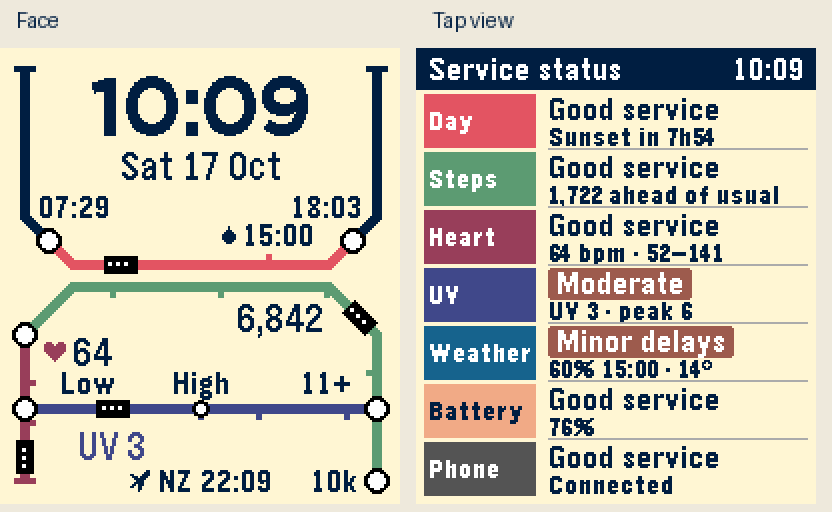

# Underground

A standalone Pebble Time 2 watchface: a day line around the clock, Heart and
Steps routes, and a purple UV connection on warm cream paper.



The face shows time, date, sun interchanges, the next rolling rain peak, current
steps, filtered current BPM, UV and a second time zone (NZ by default). Each
metric is printed once. UV's train shows the current rounded index, its five
stations start the Low/Moderate/High/Very high/Extreme bands at 0/3/6/8/11,
and an open ring marks today's maximum. Values above 12 stop at the route end.
At night the current train waits at Low; the day's peak remains marked.
Tomorrow's rain hours carry `+1`. After sunset, the sunrise station shows tomorrow's time with `+1`. Critical battery below 10% and a lost phone
appear as disruption chips. Charging and other battery states are on the board.

Tap the screen or flick the wrist for the Service status board. Another tap
returns to the face; otherwise it returns after eight seconds. The seven rows
are Day, Steps, Heart, UV, Weather, Battery and Phone. Unknown sensors and
unavailable historical heart ranges stay explicitly unknown.

## Build and install

Requires Pebble SDK/tool and Node.js. Emery is the only target.

```sh
git submodule update --init shared-kit
npm ci
pebble build
pebble install --emulator emery build/pebble-underground.pbw
pebble install --cloudpebble build/pebble-underground.pbw
```

The normal build is live (`LAB_SCENARIO=3`). `LAB_SCENARIO=0`, `1`, or `2`
selects the preserved lab demo, stress or empty fixtures. This is a watchface:
buttons retain their system roles. Updates use minute ticks, without animation.


## Shared kit development and release builds

Read [AGENTS.md](AGENTS.md) before changes: shared behaviour belongs in
`shared-kit`; design/artwork and per-face options belong here. The kit's tests
and implementation have one source. `src/c/kit`, `src/pkjs/kit`, `src/c/lab.h`
and `src/c/lab_common.c` are links into the submodule. Each app retains its
existing phone storage namespace, UUID, settings and persistence format.
Signal Deck is not a kit consumer.

```sh
npm test                         # shared suite plus this face's checks
npm run release                  # automatically fetch latest kit main, test and clean-build live
npm run release -- --render       # additionally run the full scene coverage
npm run release -- --pinned       # use current kit without network access
npm run kit:update               # fetch the kit without building
```

`pebble build` stays offline with respect to the kit and supports unfinished kit
edits. Release builds refuse unfinished/unpublished kit work or a failed fetch.
The PBW and `build/<watchface>.provenance.json` record the result and exact kit
revision; the receipt also contains the PBW SHA-256. These commands do not
publish to the Pebble store. Commit the updated submodule revision with an app
release. For a historical rebuild, check out that app revision, run
`git submodule update --init shared-kit`, then use the pinned command.

## Settings and data

Clay provides watch/12/24-hour format, Celsius/Fahrenheit, step goal (default
10,000), second time zone (NZ/UTC/LON/NYC/LA/TKY/SYD), weather on/off and opt-in
health demo fallback (off by default). Changes apply immediately and persist.
The optional Mondrian caption setting is not exposed here.

Version 1.0.3 reconstructs the Heart row's daily range from valid recorded
minute BPMs since local midnight, including history recorded under other faces.
An asterisk after the range marks incomplete/loading history; dashes mean no
usable records. The range stays available if the current filtered reading
expires. Minute records do not capture every brief sub-minute peak. The transit
layout and current-BPM sensor policy are unchanged.

The watch requests Open-Meteo every 30 minutes. Serialized phone messages,
a 45-second watchdog, 1/5/15-minute retries and an atomic three-hour weather
cache are documented in the [shared kit](shared-kit/docs/copied-kit-history.md). Health events capture fresh
readings while coalescing expensive history work; they do not trigger redraws.
Weather data: [Open-Meteo](https://open-meteo.com/).

## Layout and verification

Original upper geometry is retained: day corridor y108, arch corridor y119,
legs x12/x188 and feet y216. Time ink y14–43; date y52–69; sun labels y74–84.
The purple route is y180. Its station labels occupy y162–172, its current value
y192–205, and the world clock y211–221. Heart/vertical-leg Steps values use
y145–158; Steps on the arch uses y128–141. These separate lanes prevent the
first proposal's heart/UV collision. Seven board rows start y23 + 29×row;
the final row ends at y224, inside the 228px display.

All layout iteration used the external Watchface Lab renderer, keeping the
`LabData` / `LabDesign` contract and compiling kit modules with `LAB_HOST_RENDER`.
`tools/render_scenes.py` produces 62 scenes covering demo/stress/empty, both
views, midnight, next sunrise, 12-hour mode, units, health loss, battery/phone,
charging, UV band boundaries, short forecasts and every weather kind.
It asserts that the demo's unchanged upper bowl matches the prototype pixel
for pixel. Glance checks are in `shots/*_glance.png`; the scene sheet is
`shots/coverage.png`. Initial proposal renders are retained for comparison.

```sh
python3 tests/run.py
python3 tools/render_scenes.py
python3 ../watchface-lab/tools/render.py . shots/demo.png
python3 ../watchface-lab/tools/render.py . shots/detail.png --detail
```

The tests cover weather encoding/validation/cache/retries, phone serialization,
settings normalization, filtered current HR and permission changes, explicit
pace text, and 143,192 independent timezone comparisons from 2024–2037.

Final Emery checks passed, with face/detail frames taking **3–17 ms** in QEMU
and zero remaining allocations on exit. App footprint is 23,782 bytes with
107,290 bytes of heap available; resources total 10,759 bytes. No bitmap cache
is indicated by these emulator timings; real-watch timing remains unmeasured.
`tools/verify_emulator.py` asserts tap/timeout identity, host-matching critical
battery/phone chips, and unchanged cached map pixels after restart. Final
results are recorded in `shots/emulator*.log` and screenshots.
The test scripts use simulated health and deterministic weather injection to
exercise production AppMessage and cache paths. They do not demonstrate
physical phone geolocation, optical heart sensing or watch battery consumption.
Physical-watch validation, touch-service power A/B measurement and real-watch
frame timing remain hardware checks. Continuous touch preserves direct taps;
`KIT_TOUCH_WINDOW_MS=10000 pebble build` provides the inherited alternative.

## Files and release

- `src/c/design.c`: the diagram and Service status board.
- `src/c/lab_*`: lab contract, helpers, scenarios and shell entry point.
- `shared-kit/`: shared kit 2.0.0 Git submodule; `src/c/kit/` and `src/pkjs/kit/` link into it.
- `shots/`: verified renders and emulator evidence.
- `icon_80x80.png`, `icon_144x144.png`: static store icons.
- `STORE.md`: listing text and attribution.
- `THIRD_PARTY_LICENSES.md`: bundled font, Clay and source notices.

Version 1.0.1 is the initial public release, approved by Liam on 19 October 2026.
The app has its own UUID and no runtime dependency on another repo. Source:
https://github.com/LiamCordelle/pebble-underground.

Store: https://apps.repebble.com/c977d7b7e07b49298007a427

The release was audited against Mondrian 1.0.4, kit 1.1, commit
`8b40d001a8169d8bdf2ea23766bb4fe558e9ef8c`. Its filtered current-heart-rate
availability fix, same-minute sample handling, health regression tests, weather
reliability, settings and serialized phone messages are already included.
Underground retains its local kit 1.2 additions for explicit pace wording.

Store assets are `store/emery_face.png`, `store/emery_detail.png`, the two root
icons and `store/description.txt`. Publishing uses a clean build and checks the
PBW's embedded UUID and version. See `CHANGELOG.md` and `shared-kit/README.md`.
Ask Liam before future branches, remotes, commits or publications; use
`liamcordelle1234@gmail.com` for commits.

1.0.3 validation (20 October 2026): all protocol, health and minute-history
tests passed, including older records, gaps, permission loss, incremental reads
and 143,192 timezone comparisons. All 62 render scenes passed; the original
upper bowl remains pixel-identical. Final clean-profile Emery testing verified
the active Underground UUID, current BPM 64 and the partial recorded-minute
range 64–64*, then returned after eight seconds to an identical main-face
capture. No app faults were logged. Most frame wall-clock measurements were
3–15ms, with one 1005ms measurement at the first minute boundary; these QEMU
wall-clock logs are not physical-watch CPU timings. The SDK profile was restored
and the emulator stopped. Evidence: `shots/history-*`.

Release 1.0.4: built with the shared kit 2.0.0; artwork and settings are preserved.
